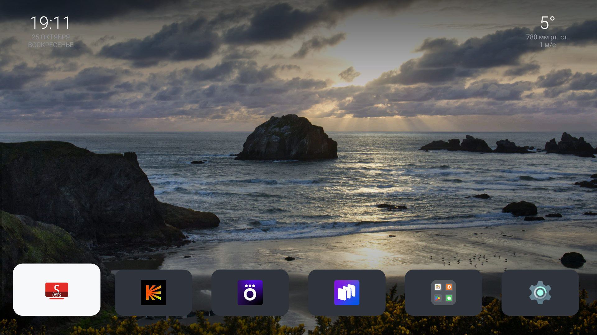
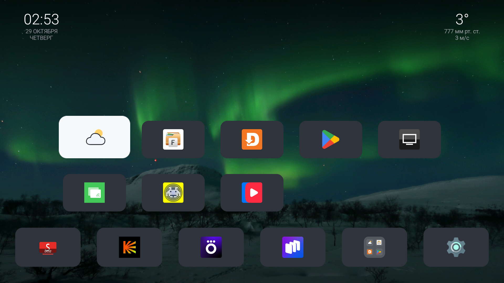

# MiTV

<p align="center">
  <strong>Лаунчер и набор обратимых инструментов для Xiaomi Android TV</strong><br>
  Управление пультом, быстрый доступ к приложениям и погода для выбранного города.
</p>

<p align="center">
  <a href="https://github.com/oblvsp/mitv/actions/workflows/tests.yml"></a>
  
  
</p>

<p align="center">
  
  
</p>

## Возможности

- **Лаунчер для пульта:** крупные плитки с плавным фокусом, док избранных приложений и папка со всеми Leanback-приложениями.
- **Погода на главном экране:** найдите город через плитку «Погода» в папке приложений. Выбор хранится локально на телевизоре.
- **Обои по дням недели:** семь пейзажей, меняются автоматически.
- **Обратимые системные настройки:** скрипты отключают выбранные пакеты, не удаляя их; критичные пакеты защищены от случайного отключения.
- **Инструменты для ADB:** подключение к ТВ, управление кнопками, получение скриншотов и проверка доступности ADB.

Погода запрашивается у MET Norway; поиск мест выполняется через Open-Meteo/GeoNames. Интернет нужен только для этих функций. Папка, док и запуск приложений работают локально.

## Совместимость

Проверено на **Xiaomi MiTV-AYFR0**, Android TV 14, интерфейс 1920×1080 при 60 Гц. Другие модели Android TV могут отличаться поведением HOME, доступными системными пакетами и настройками ADB.

## Быстрый старт

Нужны JDK 21, Android SDK Platform 34 и Build-Tools 34.0.0. Подробная настройка окружения — в [руководстве по сборке](docs/BUILD.md).

```bash
export ANDROID_SDK_ROOT="/path/to/Android/Sdk"
export JAVA_HOME="/path/to/jdk-21"
export PATH="$JAVA_HOME/bin:$ANDROID_SDK_ROOT/platform-tools:$PATH"

tools/apkbuild.sh launcher build/launcher.apk
```

Подключите ТВ по ADB и установите APK:

```bash
export TV_HOST="АДРЕС_ТЕЛЕВИЗОРА"
export TV_PORT=5555 # укажите порт подключения, показанный на ТВ
ADB_TARGET="$TV_HOST:$TV_PORT"
adb connect "$ADB_TARGET"
adb -s "$ADB_TARGET" install -r build/launcher.apk
adb -s "$ADB_TARGET" shell am start -n ru.rufp.tvlauncher/.MainActivity
```

Для Android Wireless Debugging порт сопряжения может отличаться от порта подключения. Смотрите [инструкцию по ADB](docs/REMOTE.md). После установки откройте **Папка приложений → Погода**, введите город и выберите нужный результат.

### Назначить лаунчер кнопкой HOME

Это необязательный шаг: он отключает штатный Google TV Launcher для текущего пользователя, но не удаляет его.

```bash
adb -s "$ADB_TARGET" shell pm disable-user --user 0 com.google.android.tvlauncher
```

Вернуть штатный лаунчер:

```bash
adb -s "$ADB_TARGET" shell pm enable com.google.android.tvlauncher
```

## Отключение пакетов

Деблоат не требуется для работы лаунчера. Если используете его, сначала проверьте список пакетов и отключайте только то, что понимаете:

```bash
tools/disable.sh package.name
```

Скрипт откажется отключать ряд системных и сетевых компонентов и проверит результат каждой команды. Пакеты не удаляются. `backup/restore.sh` восстанавливает список из конфигурации целевого ТВ; перед запуском на другом устройстве обязательно проверьте [`backup/packages-disabled-final.txt`](backup/packages-disabled-final.txt).

## Сборка и проверки

```bash
tests/run.sh
tools/apkbuild.sh launcher build/launcher.apk
tools/apkbuild.sh mediatest build/mediatest.apk
```

GitHub Actions запускает тесты, собирает оба APK и проверяет подписи. Проверки на реальном ТВ описаны в [docs/TESTING.md](docs/TESTING.md).

## Структура проекта

| Каталог/файл | Назначение |
|---|---|
| `launcher/` | Исходники лаунчера, ресурсы и обои |
| `tools/apkbuild.sh` | Сборка и подпись APK без Gradle |
| `tools/tv.py` | Команды ADB, кнопки пульта и скриншоты |
| `tools/disable.sh` | Защищённое отключение пакетов |
| `backup/` | Списки пакетов и сценарий восстановления для целевого ТВ |
| `docs/` | Сборка, ADB, тестирование и лицензии изображений |

## Лицензии

Исходный код распространяется по [MIT](LICENSE). Фотографии обоев имеют отдельные лицензии и авторство — см. [ASSET-LICENSES.md](ASSET-LICENSES.md). Лицензия MIT не распространяется на изображения.
